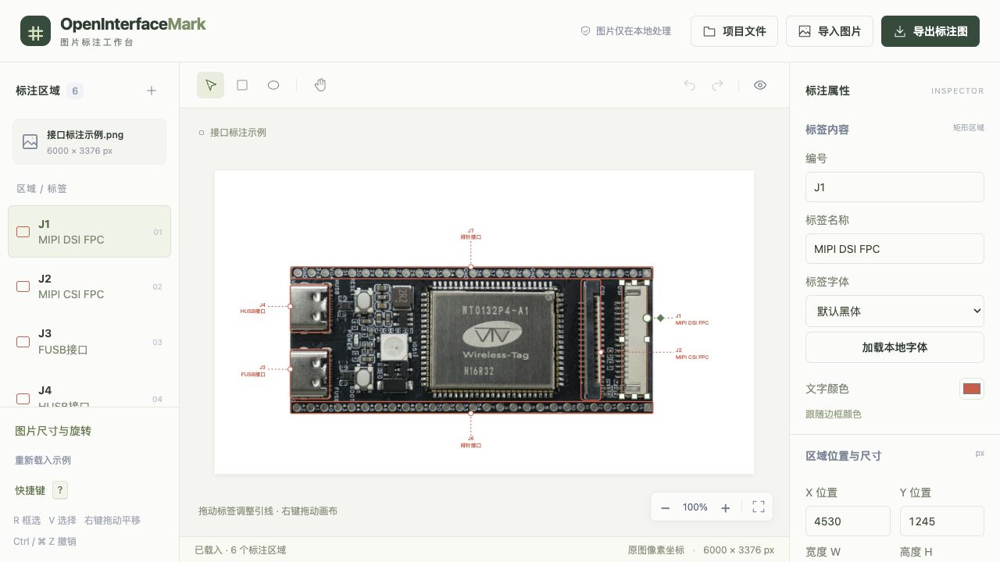
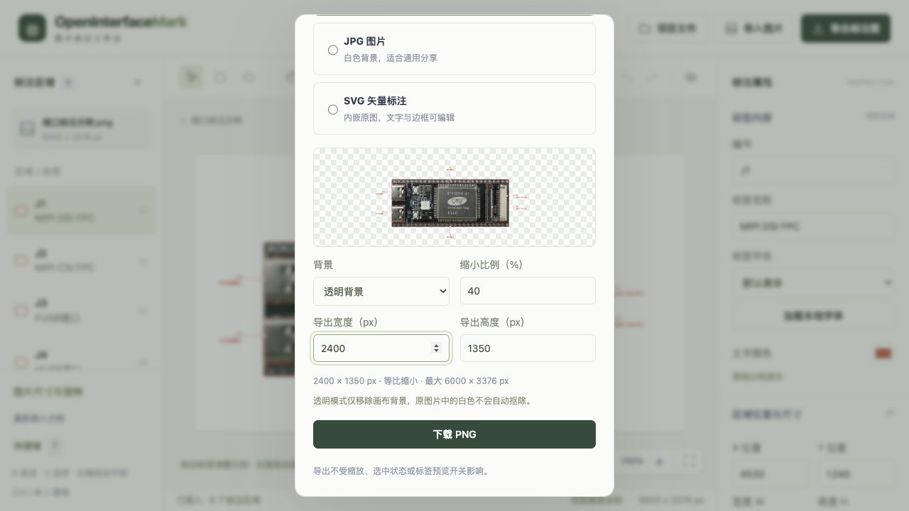
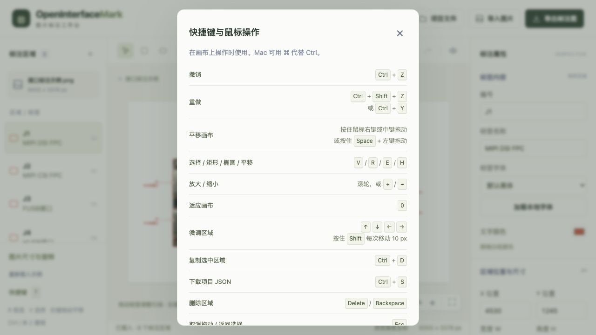

<div align="center">
  <h1>OpenInterfaceMark</h1>
  <p><strong>浏览器里的图片区域与接口标注工具</strong></p>
  <p>框选区域 · 调整引线 · 设置标签 · 下载标注图</p>
  <p>
    <a href="https://geekheart.github.io/OpenInterfaceMark/"><strong>打开在线工作台 →</strong></a>
    &nbsp; · &nbsp;
    <a href="#快速开始">本地运行</a>
    &nbsp; · &nbsp;
    <a href="#部署与版本发布">部署与版本发布</a>
  </p>
  <p><code>纯前端</code> &nbsp; <code>自由拖动引线</code> &nbsp; <code>本地字体</code> &nbsp; <code>PNG / JPG / SVG</code></p>
</div>



导入图片，在需要说明的位置绘制矩形或椭圆，再把编号与标签拖到区域外。适合制作开发板接口说明、设备部件说明和图片区域注释。界面沿用 [OpenBoxHub](https://github.com/geekheart/OpenBoxHub) 的浅色与绿色配色。

打开页面即可编辑，内置开发板图片与六处示例标注。示例框由手工近似定位，可以继续微调；工具不自动识别接口或填写标签。

图片处理、字体加载与文件生成均在浏览器中完成，无上传接口、账号、数据库或在线字体服务。项目通过 JSON 文件保存与恢复，页面不会使用 localStorage、sessionStorage 或 IndexedDB 保存设计，刷新后回到示例。

## 可以做什么

| 功能 | 说明 |
| --- | --- |
| 区域标注 | 绘制矩形或椭圆，拖动位置，使用八个手柄调整尺寸，复制或删除区域 |
| 标签样式 | 设置编号、名称、字号、文字颜色、边框颜色、线宽、圆角与引线样式 |
| 自由调整引线 | 拖动标签、圆形起点和菱形折点，也可直接拖动虚线；提供方向预设与恢复自动引线 |
| 辅助对齐 | 拖动时吸附并显示横纵辅助线，按住 Alt 临时关闭吸附 |
| 本地字体 | 默认系统黑体，可自行加载 TTF、OTF、WOFF、WOFF2 字体 |
| 图片变换 | 等比缩小图片，任意角度旋转或 90° 快捷旋转；区域随图变换，文字保持水平 |
| 画布操作 | 右键、中键或 Space + 左键平移，滚轮缩放，键盘微调与撤销/重做 |
| 图片导出 | PNG、JPG、SVG，透明或白色背景，可指定比例、宽度或高度，仅等比缩小 |
| 项目文件 | 下载和导入 JSON，保存原图、区域、标签、本地字体、图片变换与导出设置 |

## 从图片到标注图

1. 点击「导入图片」，或拖入、粘贴 PNG、JPEG、WebP 图片。
2. 选择矩形或椭圆工具，在图片上按住左键拖动绘制区域。
3. 在右侧填写编号、标签名称并调整样式；需要自定义字体时点击「加载本地字体」。
4. 拖动区域和缩放手柄调整框选范围；拖动标签安排文字位置，再拖动圆点、菱形或虚线调整引线。
5. 点击「导出标注图」下载图片。离开前通过「项目文件」下载 JSON，以便下次继续编辑。

标注使用原图像素坐标。预览缩放与平移不会改变项目坐标或导出内容。区域限制在图片内，标签可以放到图片外，导出范围会包含外置标签和引线。

左下角「图片尺寸与旋转」支持 **5%–100%** 等比尺寸、**−180°–180°** 旋转和 90° 快捷旋转。变换保留原图，不会反复重采样；可撤销修改或恢复原图尺寸与方向。图片缩小后，标注随图片等比缩小，标签文字仍保持水平。

## 字体与导出

默认黑体使用系统可用字体。加载本地字体后，可以分别为区域选择字体；缺少的字符使用系统字体回退。字体不上传，项目 JSON 包含加载的字体数据，重新导入时先校验并加载字体，再替换当前项目。



| 格式 | 背景 | 内容 |
| --- | --- | --- |
| PNG | 透明或白色 | 浏览器生成的栅格图片，适合文档与演示 |
| JPG | 白色 | 浏览器生成的栅格图片，编码质量为 92% |
| SVG | 透明或白色 | 内嵌原图与使用到的本地字体，边框、引线和文字保留为矢量 |

透明模式只移除画布背景，**不会抠除原图片里的白底**。导出不包含编辑手柄、辅助线和预览棋盘格。SVG 中的原始图片仍是位图；默认系统字体的显示取决于打开文件的设备，可使用本地字体嵌入或栅格格式保留当前文字外观。

导出比例、宽度与高度按固定比例联动，**只允许缩小**。PNG/JPG 超过 **3200 万像素**或单边 **16000 px** 时会进一步等比缩小，窗口显示实际输出尺寸。SVG 保留矢量标注，但不会增加内嵌原图的像素细节。

## 保存与恢复项目

打开「项目文件」下载 `.oim.json`，下次导入即可恢复原图、全部标注、本地字体、图片缩放与旋转，以及导出背景和比例。JSON 是继续编辑所需的项目文件，导出的 PNG、JPG、SVG 不替代它。

替换未保存项目时，可以取消、先保存或直接替换。导入文件通过结构、图片真实解码尺寸和字体校验后，才一次性替换当前项目；失败时保留原设计。

刷新或离开页面前，请下载需要保留的项目。撤销历史只存在于当前页面，不写入项目文件。

## 快捷键



| 操作 | 快捷键 |
| --- | --- |
| 选择 / 矩形 / 椭圆 / 平移 | V / R / E / H |
| 临时平移 | 右键或中键拖动；也可按住 Space + 左键拖动 |
| 缩放 / 适应画布 | 滚轮、+ / −、右下角按钮 / 0 |
| 微调选中区域 | 方向键；按住 Shift 每次移动 10 px |
| 撤销 | Ctrl / ⌘ + Z |
| 重做 | Ctrl / ⌘ + Shift + Z，也支持 Ctrl / ⌘ + Y |
| 复制选中区域 | Ctrl / ⌘ + D |
| 下载项目 JSON | Ctrl / ⌘ + S |
| 删除区域 | Delete 或 Backspace |
| 取消当前绘制或拖动 | Escape |
| 快捷键帮助 | ? 或左下角「快捷键」 |

输入框内保留原生文字编辑快捷键；点击画布后，快捷键作用于标注。右键平移保留当前工具和选中区域。画布平移和预览缩放不进入撤销历史，撤销普通标注时保留当前视图；撤销图片尺寸或旋转时重新适应画布。拖动中按撤销先取消当前拖动，再按一次才撤销上一项修改。

## 快速开始

使用 **Node.js 24** 与 **pnpm 11.19.0**。项目没有运行时或开发依赖，保留冻结锁文件安装，便于本地与 Actions 使用相同流程。

```bash
git clone https://github.com/geekheart/OpenInterfaceMark.git
cd OpenInterfaceMark
npm install --global pnpm@11.19.0
pnpm install --frozen-lockfile
pnpm dev --port 5180
```

打开终端显示的 [本地工作台](http://127.0.0.1:5180/)。也可直接使用 `node scripts/serve.mjs --port 5180` 启动。

```bash
pnpm test
pnpm build
pnpm preview --port 4180
```

生产检查访问 [构建产物预览](http://127.0.0.1:4180/OpenInterfaceMark/)，同时验证仓库子路径。`dist/` 是完整静态产物，可通过 HTTP 静态服务托管。浏览器 ES 模块需要 HTTP 服务，请勿直接双击 HTML 通过 `file://` 打开。

## 部署与版本发布

仓库：[geekheart/OpenInterfaceMark](https://github.com/geekheart/OpenInterfaceMark)；在线入口：[geekheart.github.io/OpenInterfaceMark](https://geekheart.github.io/OpenInterfaceMark/)。

在仓库 **Settings → Pages** 中，将 Source 设为 **GitHub Actions**。`github-pages` environment 需要允许 `main` 和发布标签部署。资源使用相对路径，支持 `/OpenInterfaceMark/` 等仓库子路径。

### 日常部署

[pages.yml](.github/workflows/pages.yml) 在推送 `main` 时安装锁定依赖、运行测试、构建并部署 `dist/`；PR 只执行验证。也可以在 Actions 页面选择该工作流，从 `main` 手动运行。

### 发布版本

[release.yml](.github/workflows/release.yml) 负责按标签发布。发布 **V1.0.1** 时，先将 `package.json` 的版本设为 `1.0.1`，编写 [版本说明](docs/releases/1.0.1.md)，并把待发布内容提交到 `main`。然后在 Actions 页面选择 **Release** 工作流，在 `main` 上运行，将 `tag` 输入为 `V1.0.1`。

也可推送 `v*` 或 `V*` 标签触发：

```bash
git tag V1.0.1
git push origin V1.0.1
```

两种方式选择一种即可。标签必须是 `v` 或 `V` 加三段正式版本，去掉前缀后与 `package.json` 一致，且对应提交包含发布工作流和 `docs/releases/{版本}.md`。已有标签若指向不同提交，或该版本已有 Release，工作流会停止；后续发布使用新版本号。

Release 工作流先测试、构建，再将同一份 `dist/` 部署到 Pages，部署成功后创建 GitHub Release，并附上：

- `OpenInterfaceMark-V1.0.1-site.zip`：压缩包根目录含 `index.html`、`src/`、`public/` 和 `version.json`，可直接用于静态托管。
- `SHA256SUMS.txt`：发布压缩包的 SHA-256 校验值。

其他版本使用对应标签命名。GitHub Release 页面同时提供该标签的源码下载。日常部署和版本发布共用生产并发组，避免两个工作流同时写入站点。

发布后应核对 Actions 成功状态、Release 附件、实际线上页面和 `version.json` 中的版本、提交与标签。仅创建本地标签、构建成功或上传 artifact 均不代表站点已发布。

## 数据格式与限制

项目 JSON 使用 `format: "open-interface-mark"`、`version: 1`。图片以 data URL 内嵌；区域包含稳定 ID、形状、原图像素矩形、编号、名称、标签位置、引线起点/折点及样式。导入只接收定义字段，校验有限数值、合法范围、唯一 ID 与字体引用。

| 项目 | 限制 |
| --- | --- |
| 输入图片 | PNG / JPEG / WebP，最多 32 MB、6400 万像素，单边最多 16000 px |
| 项目 JSON | 最多 160 MB，最多 300 个区域 |
| 标注文字 | 编号最多 40 字，标签名称最多 160 字 |
| 本地字体 | 最多 8 个，单个最多 32 MB，总量约 64 MB |
| 撤销历史 | 最近 80 次标注和图片变换修改 |

浏览器按实际字体测量标签边界，为文字和引线留出导出范围。支持 WebMCP 的浏览器还可调用 `list_annotations` / `update_annotation`，与可见界面共用校验、状态和撤销记录；不支持时不影响普通使用。

## 结构与验证

| 文件 | 职责 |
| --- | --- |
| `index.html` | 工作台、属性面板和弹窗结构 |
| `src/app.js` | 界面、鼠标/键盘手势、文件导入导出、字体和撤销历史 |
| `src/core.js` | 坐标变换、区域边界、引线、SVG 与项目格式校验 |
| `src/styles.css` | 桌面三栏工作台、窄屏布局与浅绿配色 |
| `scripts/serve.mjs` / `scripts/build.mjs` | 无依赖 HTTP 服务器与静态构建 |
| `tests/core.test.mjs` | 坐标、引线、图片变换、项目往返及 SVG 导出回归 |
| `tests/interaction.test.mjs` | 使用 Node VM 执行实际事件处理器的键盘与指针交互回归 |

当前自动测试共 **32 项**。交互测试使用轻量 DOM、指针捕获与坐标矩阵替身，不能代替浏览器实际操作与导出文件检查。浏览器检查范围及已知限制见 [验证记录](docs/verification.md)；开发与发布约定见 [AGENTS.md](AGENTS.md)。
